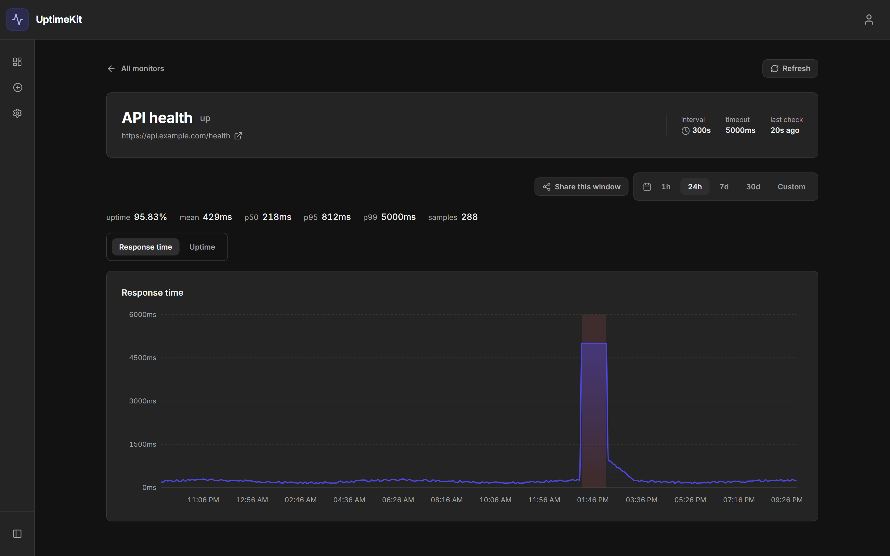
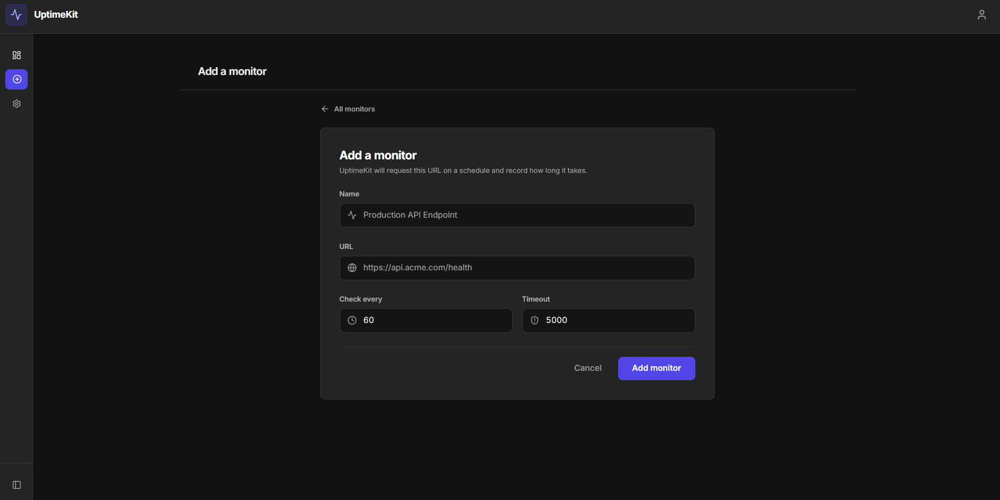

# UptimeKit

**Is my website up? And how fast was it, really?**

UptimeKit answers both. You give it a list of web addresses to watch. It checks
each one on a schedule, around the clock, and keeps a permanent record: when it
went down, how long it stayed down, and how quickly it responded on every check
in between. When something breaks it messages your team on Slack or Discord
within seconds.

It is the same idea as Pingdom or UptimeRobot, built from scratch.

***

## Screenshots

<p align="center">
  
  <br><em>The monitors list. Anything broken sorts to the top.</em>
</p>

<p align="center">
  
  <br><em>One monitor over 24 hours: an outage, the timeout plateau, and the recovery after it.</em>
</p>

<p align="center">
  
  <br><em>Adding a monitor: a URL, how often to check it, and when to give up.</em>
</p>

<sub>The first two use example endpoints and demo data.</sub>

***

## What it does

| <br />                             | <br />                                                                 |
| ---------------------------------- | ---------------------------------------------------------------------- |
| **Watches endpoints**              | Any public URL, checked as often as every 30 seconds                   |
| **Tracks speed, not just up/down** | Median, 95th and 99th percentile response times, charted over time     |
| **Records outages**                | Start, end, duration, and the HTTP error behind it                     |
| **Alerts your team**               | Slack, Discord, or a plain JSON webhook, fired the moment status flips |
| **Shares a read-only link**        | Send a graph to someone without giving them an account                 |
| **Keeps teams separate**           | Invite teammates as admin or viewer; each team sees only its own data  |

***

## Why I built it

<!-- Replace this section with your own story: why you picked this project,
     what you wanted to learn. The paragraphs below are a placeholder. -->

Uptime monitoring looks trivial until you try to store the data. One endpoint
checked every 30 seconds produces about a million rows a year; ten produce ten
million, and "show me last year's response times" stops being a query and
starts being a design problem. UptimeKit keeps three tiers of the same data,
every individual check for the recent past, hourly summaries behind that, daily
summaries behind that, and the chart picks whichever tier can answer the
question asked. Old detail is rolled up and discarded on a schedule, so storage
stays flat instead of growing forever.

The second interesting part was making it multi-tenant without trusting the
application code to get it right. Every table is scoped by team inside the
database itself using Postgres row level security, so a bug in a query cannot
leak one team's monitors to another, the database refuses to return the rows.

***

## How it works

```
                  ┌──────────────┐
   you ──────────▶│ Web dashboard│──────┐
                  │  (Next.js)   │      │
                  └──────────────┘      ▼
                                   ┌──────────┐
                                   │ Supabase │  ← auth + Postgres + RLS
                                   │ Postgres │
                                   └──────────┘
   the internet ◀──┌──────────────┐      ▲
   (your URLs)     │    Worker    │──────┘
                   │ (BullMQ+Redis)│
                   └──────────────┘
```

Two runnable programs, one database, no API server between them.

| <br />           | Stack                                 | Job                                                              |
| ---------------- | ------------------------------------- | ---------------------------------------------------------------- |
| **`src/web`**    | Next.js 14, React, Tailwind, Recharts | The dashboard. Talks to Postgres directly from Server Components |
| **`src/worker`** | Node, BullMQ, Redis                   | Pings the URLs, writes results, rolls up old data, sends alerts  |

The web app queries **as the signed-in user**, so row level security enforces
team isolation. The worker connects as `postgres` and bypasses it on purpose:
it is a trusted backend process with no user input in its query path.

***

## Run it locally

**You need:** [Node 22+](https://nodejs.org), a free
[Supabase](https://supabase.com) project, and [Docker](https://docker.com) for Redis.

**1. Clone and install**

```bash
git clone https://github.com/kcotiru/UptimeKit.git
cd UptimeKit
npm install
cd src/web && npm install && cd ../..
```

**2. Create the database.** In your Supabase project: **SQL Editor → New query**,
paste [`supabase/schema.sql`](supabase/schema.sql), **Run**.

**3. Turn on email confirmation.** **Authentication → Providers → Email →
Confirm email: on**. Not optional: without it an unverified address can sign in.

**4. Fill in four values**

```bash
cp .env.example .env
cp src/web/.env.local.example src/web/.env.local
```

| File                 | Variable                        | Where it comes from                                                            |
| -------------------- | ------------------------------- | ------------------------------------------------------------------------------ |
| `src/web/.env.local` | `NEXT_PUBLIC_SUPABASE_URL`      | Project Settings → API → Project URL                                           |
| `src/web/.env.local` | `NEXT_PUBLIC_SUPABASE_ANON_KEY` | Project Settings → API → `anon` key                                            |
| `.env`               | `DATABASE_URL`                  | Project Settings → Database → **Session pooler** string, not Direct connection |
| `.env`               | `REDIS_URL`                     | `redis://localhost:6379`                                                       |

**5. Start it**

```bash
cd src/web && npm run dev    # dashboard on http://localhost:3001
docker run -d --name uptimekit-redis -p 6379:6379 redis:7-alpine

npm run worker               # second terminal, from the repo root
```

Register, confirm your email, add a monitor. It flips from `unknown` within
about 30 seconds.

Why each step, the pooler choice, schema changes and optional settings:
**[docs/setup.md](docs/setup.md)**.

***

## Tests

```bash
npm test                 # worker: 119 tests
cd src/web && npm test   # web: 157 tests
```

Both pass from a clean clone with no database configured. 49 further worker
tests are database-backed and skip themselves unless you point
`DATABASE_TEST_URL` at a throwaway Postgres. See
[docs/setup.md](docs/setup.md#database-backed-tests).

***

## Known issues & to-do

**Bugs**

* **Three components disagree on what "success" means.** The worker, the hourly
  rollup and the dashboard each decide differently, so a permanent redirect
  would show a red `down` badge next to `uptime 100%`. Latent today:
  everything monitored returns `200`.

* **Recent-metrics labelling on the live tier.** For young monitors the list
  view shows the most recent sample where it labels p50 and p99. Correct
  number, overstated label.

**Unfinished**

* [ ] Theme and Timezone in the account menu are visible but disabled.

* [ ] Email uses Supabase's built-in sender: a few messages an hour, and only
  to addresses attached to the Supabase project.

Full write-ups, including why each one is still open:
**[docs/known-issues.md](docs/known-issues.md)**.

***

## Docs

| <br />                                         | <br />                                                  |
| ---------------------------------------------- | ------------------------------------------------------- |
| [docs/setup.md](docs/setup.md)                 | Optional config, test database, seed data, feature tour |
| [docs/operations.md](docs/operations.md)       | Schema deploy order, migrations, partition maintenance  |
| [docs/known-issues.md](docs/known-issues.md)   | Bugs and to-do in detail                                |
| [docs/security.md](docs/security.md)           | What is defended, what is accepted, and why             |
| [docs/design-system.md](docs/design-system.md) | Colour, type and component conventions                  |

***

## Repo layout

```
src/web/          Next.js dashboard
src/worker/       Ping scheduler, rollups, alerting
supabase/         schema.sql: tables, RLS policies, functions, cron
scripts/          Dev seeding and rollup backfill
tests/            Worker suite
docs/             Setup, operations, known issues, design system, plans
```
