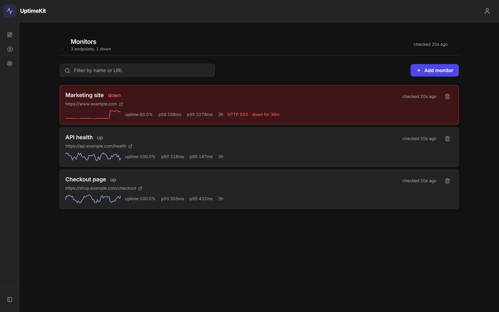

# UptimeKit

**Is my website up? And how fast was it, really?**

UptimeKit answers both. You give it a list of web addresses to watch. It checks
each one on a schedule, around the clock, and keeps a permanent record: when it
went down, how long it stayed down, and how quickly it responded on every check
in between. When something breaks it messages your team on Slack or Discord
within seconds.

It is the same idea as Pingdom or UptimeRobot, built from scratch.

---

## Screenshots

<!-- Drop the PNGs into docs/images/ and delete this comment to publish them.
<p align="center">
  
  <br><em>The monitors list — anything broken sorts to the top.</em>
</p>
<p align="center">
  
  <br><em>One monitor: response time over 24 hours, outages shaded in red.</em>
</p>
-->

> _Screenshots pending — see `docs/images/`._

---

## What it does

|  | |
| --- | --- |
| **Watches endpoints** | Any public URL, checked as often as every 30 seconds |
| **Tracks speed, not just up/down** | Median, 95th and 99th percentile response times, charted over time |
| **Records outages** | Start, end, duration, and the HTTP error behind it |
| **Alerts your team** | Slack, Discord, or a plain JSON webhook, fired the moment status flips |
| **Shares a read-only link** | Send a graph to someone without giving them an account |
| **Keeps teams separate** | Invite teammates as admin or viewer; each team sees only its own data |

---

## Why I built it

<!-- Replace this section with your own story — why you picked this project,
     what you wanted to learn. The paragraphs below are a placeholder. -->

Uptime monitoring looks trivial until you try to store the data. One endpoint
checked every 30 seconds produces about a million rows a year; ten produce ten
million, and "show me last year's response times" stops being a query and
starts being a design problem. UptimeKit keeps three tiers of the same data —
every individual check for the recent past, hourly summaries behind that, daily
summaries behind that — and the chart picks whichever tier can answer the
question asked. Old detail is rolled up and discarded on a schedule, so storage
stays flat instead of growing forever.

The second interesting part was making it multi-tenant without trusting the
application code to get it right. Every table is scoped by team inside the
database itself using Postgres row level security, so a bug in a query cannot
leak one team's monitors to another — the database refuses to return the rows.

---

## How it works

```
                  ┌──────────────┐
   you ──────────▶│ Web dashboard│──────┐
                  │  (Next.js)   │      │
                  └──────────────┘      ▼
                                   ┌──────────┐
                                   │ Supabase │  ← auth + Postgres + RLS
                                   │ Postgres │
                                   └──────────┘
   the internet ◀──┌──────────────┐      ▲
   (your URLs)     │    Worker    │──────┘
                   │ (BullMQ+Redis)│
                   └──────────────┘
```

Two runnable programs, one database, no API server between them.

| | Stack | Job |
| --- | --- | --- |
| **`src/web`** | Next.js 14, React, Tailwind, Recharts | The dashboard. Talks to Postgres directly from Server Components |
| **`src/worker`** | Node, BullMQ, Redis | Pings the URLs, writes results, rolls up old data, sends alerts |

The web app queries **as the signed-in user**, so row level security enforces
team isolation. The worker connects as `postgres` and bypasses it on purpose —
it is a trusted backend process with no user input in its query path.

---

## Run it locally

**You need:** [Node 22+](https://nodejs.org), a free
[Supabase](https://supabase.com) project, and [Docker](https://docker.com) (for
Redis — only if you want the worker).

**1. Clone and install**

```bash
git clone https://github.com/kcotiru/UptimeKit.git
cd UptimeKit

npm install              # worker
cd src/web && npm install && cd ../..
```

**2. Create the database** — Supabase project → **SQL Editor** → **New query**.
Paste all of [`supabase/schema.sql`](supabase/schema.sql) and hit **Run**. It is
idempotent, so re-running it later is safe.

Then tell the migration runner that file is your starting point, so later schema
changes can stack on top of it (this needs `DATABASE_URL` from step 4, so come
back to it after filling in `.env`):

```bash
MIGRATE_CONFIRM=<your-project-ref> npm run migrate -- --hosted --baseline-only
```

`--hosted` aims it at your real project, so it refuses to run until you confirm
which one: `MIGRATE_CONFIRM` is your Supabase project ref, the `<project-ref>` in
your project URL. (PowerShell needs `$env:MIGRATE_CONFIRM='…'` on its own line —
see [docs/operations.md](docs/operations.md#environment-variables-in-powershell).)

On a brand-new project that command is all there is to it. **On a database that
has been running for a while, verify it first:** recording the baseline without
executing it asserts the database already equals `schema.sql`, and once that row
exists, drift that predates it can never be detected. Run the parity audit first
— [docs/operations.md → Baselining an existing
project](docs/operations.md#baselining-an-existing-project). More on migrations
in [`supabase/migrations/README.md`](supabase/migrations/README.md).

**3. Turn on email confirmation** — Supabase → **Authentication → Providers →
Email** → switch **Confirm email** to **on**. Skip this and verification means
nothing: `signUp()` hands back a working session immediately, so any unverified
address can sign straight in.

**4. Fill in four values** — two files, two variables each. Nothing else is
required, and no paths need editing.

```bash
cp .env.example .env                                # worker
cp src/web/.env.local.example src/web/.env.local    # web
```

| File | Variable | Where it comes from |
| --- | --- | --- |
| `src/web/.env.local` | `NEXT_PUBLIC_SUPABASE_URL` | Project Settings → API → Project URL |
| `src/web/.env.local` | `NEXT_PUBLIC_SUPABASE_ANON_KEY` | Project Settings → API → `anon` key |
| `.env` | `DATABASE_URL` | Project Settings → Database → **Session pooler** string |
| `.env` | `REDIS_URL` | `redis://localhost:6379` |

> ⚠️ Pick **Session pooler**, not *Direct connection*. `db.<ref>.supabase.co`
> is IPv6-only, so on an IPv4 network the worker hangs and then dies with
> `ENOTFOUND`.

No `service_role` key is needed anywhere — a database trigger creates the team
at signup, so the RLS-bypassing key never touches a request path.

**5. Start the dashboard**

```bash
cd src/web && npm run dev
```

Open **http://localhost:3001**, register, click the confirmation email, log in.
That alone is a working app. Monitors you add sit at `unknown` until something
pings them, which is step 6.

**6. Start the worker** — it needs Redis, which Supabase does not provide:

```bash
docker run -d --name uptimekit-redis -p 6379:6379 redis:7-alpine
npm run worker           # second terminal, from the repo root
```

Within about 30 seconds your monitors flip from `unknown` to `up` and the
charts start filling in. The container survives reboots —
`docker start uptimekit-redis` brings it back.

Optional settings, webhooks, invites and shared links:
**[docs/setup.md](docs/setup.md)**.

---

## Tests

```bash
npm test                 # worker: 112 tests
cd src/web && npm test   # web: 135 tests
```

Both pass from a clean clone with no database configured. 48 further worker
tests are database-backed and skip themselves unless you point
`DATABASE_TEST_URL` at a throwaway Postgres — see
[docs/setup.md](docs/setup.md#database-backed-tests).

---

## Known issues & to-do

**Bugs**

- **Three components disagree on what "success" means.** The worker, the hourly
  rollup and the dashboard each decide differently, so a permanent redirect
  would show a red `down` badge next to `uptime 100%`. Latent today —
  everything monitored returns `200`.
- **Recent-metrics labelling on the live tier.** For young monitors the list
  view shows the most recent sample where it labels p50 and p99. Correct
  number, overstated label.

**Unfinished**

- [ ] Theme and Timezone in the account menu are visible but disabled.
- [ ] No landing page; `/` redirects straight to the dashboard.
- [ ] Email uses Supabase's built-in sender: a few messages an hour, and only
      to addresses attached to the Supabase project.

Full write-ups, including why each one is still open:
**[docs/known-issues.md](docs/known-issues.md)**.

---

## Docs

| | |
| --- | --- |
| [docs/setup.md](docs/setup.md) | Optional config, test database, seed data, feature tour |
| [docs/operations.md](docs/operations.md) | Schema deploy order, migrations, partition maintenance |
| [docs/known-issues.md](docs/known-issues.md) | Bugs and to-do in detail |
| [docs/design-system.md](docs/design-system.md) | Colour, type and component conventions |
| [docs/superpowers/](docs/superpowers) | Design docs and implementation plans, by date |

---

## Repo layout

```
src/web/          Next.js dashboard
src/worker/       Ping scheduler, rollups, alerting
supabase/         schema.sql — tables, RLS policies, functions, cron
scripts/          Dev seeding and rollup backfill
tests/            Worker suite
docs/             Setup, operations, known issues, design system, plans
```
